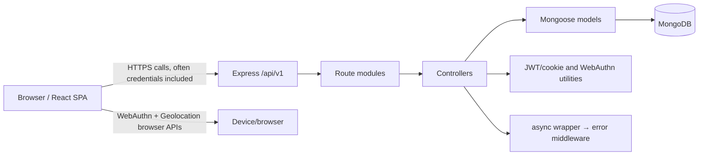

# Architecture

## Overview (confirmed)

This is a two-process browser/API design. React renders routes in the browser. Page components directly call the Express API. Express routes dispatch to controllers, which use Mongoose models for MongoDB. Authentication combines password/JWT-cookie endpoints with WebAuthn passkey ceremonies.

## Dependency direction

`backend/index.js → app.js → routes → controllers → models/utils → MongoDB`. `app.js` installs CORS, cookie parsing, JSON parsing, route modules, then error middleware. The frontend is `src/index.js → App.js → page components`; components directly import CSS/assets and directly use Axios/fetch. There is no shared API client, state store, service layer, frontend route guard, or backend repository abstraction.

## Component map

| Component | Responsibility | Consumers |
| --- | --- | --- |
| `attendance-backend/index.js` | loads config, initiates Mongo connection, starts listener, process-error handling | npm start |
| `app.js` | Express middleware and `/api/v1` composition | `index.js` |
| routes/controllers/models | HTTP API, business/persistence behavior | `app.js` / each other |
| `attendance-frontend/src/index.js` | React root render | CRA HTML shell |
| `src/App.js` | route registry | `index.js` |
| page components | UI and API/browser calls | route registry |

## Confirmed architectural limits and risks

- No active route applies the implemented JWT middleware; no route declares role authorization. This includes room/code mutation endpoints.
- The source contains no attendance-record model or endpoint. The frontend's attendance flow finishes by showing a client-side location result; server-side attendance persistence is not established.
- `UniqueCode` has no `expiresAt` schema field even though controller code queries/calculates it. Expiration does not have a coherent implementation in the checked-out code.
- Traditional `POST /register` only passes email/password into `User.create`, although the schema requires `name`; it also pre-hashes a password that the model pre-save hook hashes again. This endpoint cannot be assumed to be a working canonical registration path.
- The components hard-code a deployed API base URL in multiple locations; environment switching is not centralized.
- Console output is the only observed logging. No metrics, tracing, external error reporting, caching, queue/event bus, retry policy, or timeout policy is configured.

These are source observations, not claims about intended product design.
