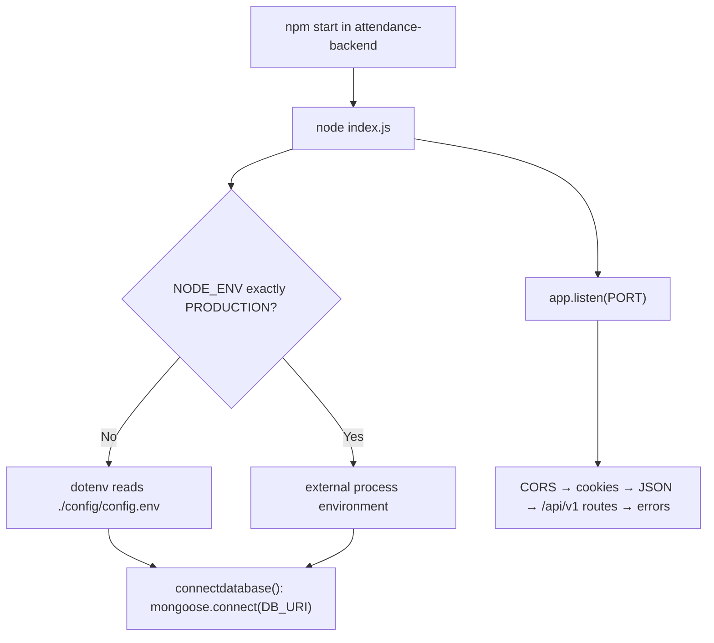
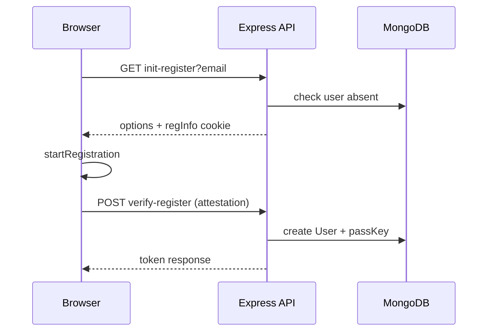

# Runtime flows

## Backend startup (confirmed)

`connectdatabase()` is not awaited; listening can begin before connection success. Its rejection is not locally caught.

## Password login

`POST /api/v1/login` → validate email/password → `User.findOne(email)` → bcrypt compare → `sendToken` → signed JWT plus secure/httpOnly/sameSite=none cookie and JSON response.

`POST /register` passes only email/password to `User.create`, while the User schema requires `name`; it also hashes once in the controller and again in the User pre-save hook. A single bcrypt compare is used at login. This is a confirmed schema/controller conflict; the resulting behavior needs a disposable-DB test before relying on it.

## Passkey registration and authentication

Authentication obtains options, verifies the assertion, and updates the stored credential counter. It returns `{success:true}`; it does not issue a JWT in that controller.

## Room/code/marking flow

Teacher room setup captures four browser geolocation samples and posts `{roomNo, coordinates}` to `/admin/addRoom`. Teacher code creation posts batch/year/course/room to `/genCode`. A student submits a six-digit value, completes passkey authentication, gets browser location, then requests `/getCode` and `/getRoom`. `Mark.jsx` checks the current coordinate against min/max lat/long values locally and displays a result.

There is no confirmed request that persists an attendance mark. The backend lacks an attendance model/endpoint; final business effect beyond the displayed client message is **UNKNOWN**.
